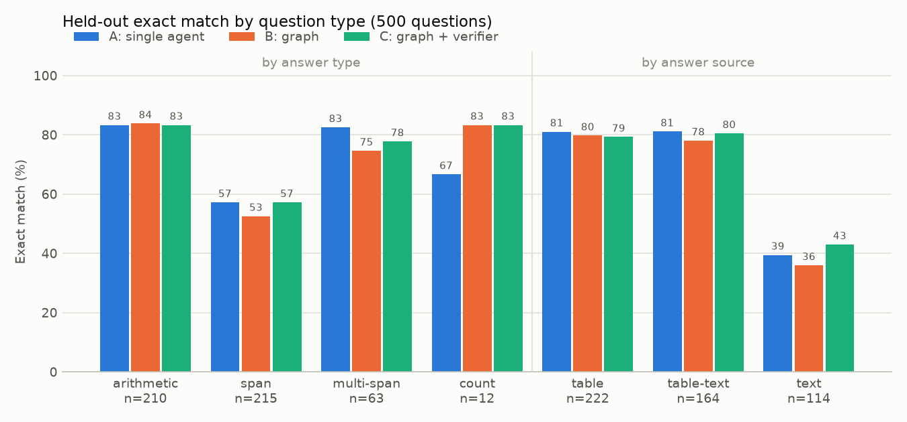
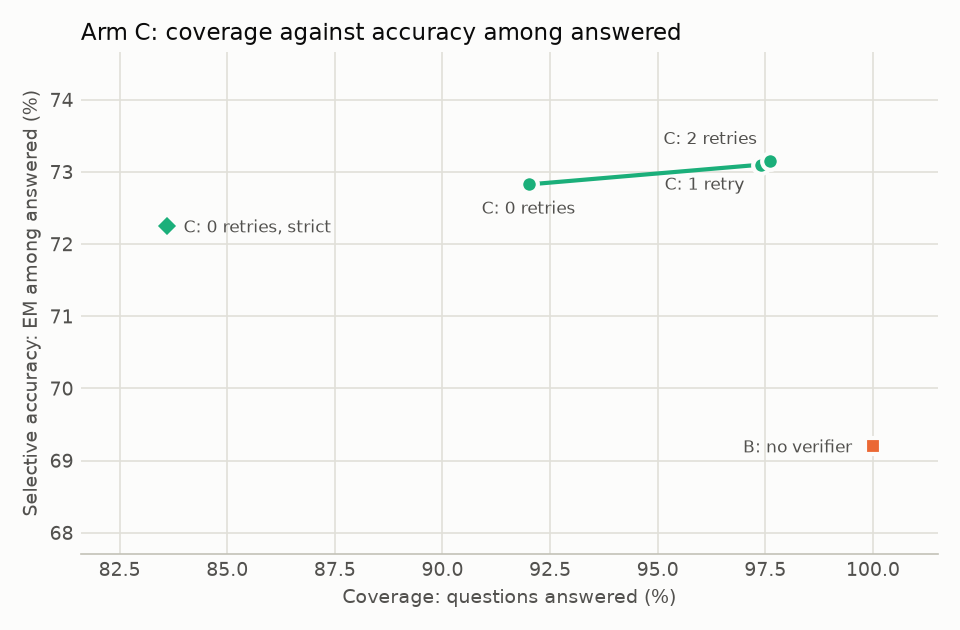
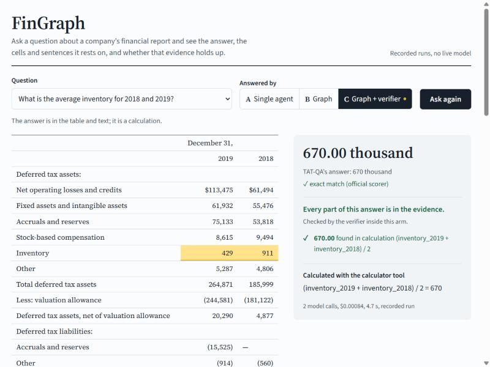

# FinGraph

A LangGraph multi-agent analyst that answers questions over financial reports that mix
tables and text (TAT-QA), and an honest experiment on whether graph orchestration beats a
single tool-loop agent that has the same tools and the same model.

**Status:** the experiment is finished and written up below. **Try it:** the
[recorded demo](https://nischalparulekar.github.io/fingraph/) replays real runs at no cost,
and the [live demo](https://nischalparulekar.github.io/fingraph/live/) asks the API, which
runs on Render's free tier at <https://fingraph-api-3psv.onrender.com> (it sleeps when idle,
so the first request can take a minute). The AWS deployment is written but not running.
Every number in this README comes from a committed run in `results/` with its config and
raw outputs.

## In short

- **The graph does not beat the single agent.** On 500 held-out TAT-QA questions, a
  LangGraph pipeline of specialised steps scored 69.2% exact match against 71.6% for one
  tool-using agent with the same model and tools (p = 0.18), and cost 1.48x as much as
  billed.
- **The verifier is what helps.** Adding an evidence verifier to the graph cut
  confidently wrong answers from 30.8% to 26.2% (p = 0.0014) at the price of 2.4%
  abstentions, bringing the graph level with the single agent on accuracy.
- **It catches made-up numbers, not wrong-but-grounded ones.** Most remaining errors are
  answer form (a span a word too long) or a right number from the wrong row; about 1 in
  12 sampled failures looks like an error in the benchmark itself.
- **Try it:** the demo UI replays recorded runs with the evidence marked in the report,
  and against the live API it shows a paused answer for a person to approve, correct or
  reject (screenshot under [The demo UI](#the-demo-ui)).

## Research question

On hybrid table+text financial QA, does a LangGraph pipeline of specialised nodes beat a
single tool-using agent with the same tools and the same model, in accuracy, cost and
confidently-wrong answers?

## Hypotheses (fixed before any held-out run)

These were committed before any arm was run on the held-out set; `git log -- README.md`
shows that. They are not edited after results exist. A failed hypothesis is reported as
failed.

- **H1 (orchestration).** Arm B (graph, no verifier) has a higher exact match than
  Arm A (single agent) on the held-out set.
- **H2 (verifier).** Arm C (graph + verifier) has a lower confident-wrong rate than
  Arm B, at the cost of a higher abstention rate and more tokens per question.
- **H3 (cost).** Arm B costs more per question than Arm A. The write-up states how much
  more, and whether the accuracy difference (if any) is worth it.

### How they will be tested

- **Data.** 500 held-out questions from the official TAT-QA test split (whose gold
  answers are public), stratified by `answer_from` × `answer_type`, seed 42, IDs
  committed in `splits/heldout.json`. All development uses a separate 150-question subset
  of the official dev split (`splits/dev.json`). Nothing is tuned on the held-out set.
- **Scoring.** The official TAT-QA scorer (vendored unchanged in
  `fingraph/eval/tatqa_official/`): exact match (EM) and numeracy-focused F1, both
  scale-aware. Other metrics are defined in [METRICS.md](METRICS.md).
- **Tests.** Paired, per question, two-sided exact sign test: A vs B on EM (H1); B vs C
  on confident-wrong (H2). Report n, wins, losses, ties and p. A hypothesis is
  supported only if the difference is in the predicted direction with p < 0.05.
  Proportions carry Wilson 95% intervals. H3 is descriptive (cost per 1k questions,
  measured from token usage).
- **Fairness.** All arms use the same model, the same effort setting, the same tool
  implementations (DuckDB table sandbox, retriever, calculator) and the same answer
  format. Only the orchestration and the verifier differ.

## Arms

All three use Claude Haiku 5.5 at the same `effort`, the same three tools and the same
answer rules; only the orchestration and the verifier differ.

| Arm | Description |
|---|---|
| A: single agent | One tool-use loop with `query_table` (DuckDB), `retrieve_text`, `calculate`. |
| B: graph | LangGraph pipeline: planner, then table / retrieval / calc nodes, then synthesizer. |
| C: graph + verifier | Arm B plus an evidence verifier with retry and abstain. |

```
Arm B   question -> planner -+-> table node ------+
                             +-> retrieval node --+-> calc node -> synthesizer -> answer

Arm C   ... synthesizer -> verifier -+- pass ----------------------------> answer
                                     +- fail, retries left --> planner, with the feedback
                                     +- fail, none left ----> human review (API) / abstain (eval)
```

Only the planner, the reader inside the retrieval node and the synthesizer call the
model; table lookups and arithmetic are deterministic, and every value keeps its table
coordinates or paragraph. The verifier (`fingraph/verifier/`) has no LangGraph imports,
so other projects can reuse it.

## Results (held-out, run once)

All three arms were frozen (tag `arms-frozen-heldout`) before this run, which is the only
one on the held-out set. `make eval` rebuilds this section's tables and tests from the
committed run files in `results/heldout/`, with no model calls. Development runs are
in [results/dev/README.md](results/dev/README.md).

Held-out set: 500 questions from the TAT-QA test split. EM, confident-wrong and abstention with Wilson 95% intervals.

| Arm | EM | F1 | Confident-wrong | Abstain | Selective acc. | Cost / 1k q | Tokens / q | LLM calls / q | p50 / p95 latency |
|---|---|---|---|---|---|---|---|---|---|
| A: single agent | 71.6% (67.5-75.4) | 0.810 | 28.4% (24.6-32.5) | 0.0% (0.0-0.8) | 71.6% | $0.56 | 6,411 | 2.45 | 3.1 / 4.2 s |
| B: graph | 69.2% (65.0-73.1) | 0.784 | 30.8% (26.9-35.0) | 0.0% (0.0-0.8) | 69.2% | $0.82 | 4,794 | 2.28 | 4.5 / 7.5 s |
| C: graph + verifier | 71.4% (67.3-75.2) | 0.794 | 26.2% (22.5-30.2) | 2.4% (1.4-4.1) | 73.2% | $0.53 | 5,357 | 2.54 | 4.6 / 10.8 s |

- **H1 (B beats A on EM): not supported.** Paired over 500 questions: B right and A wrong on 28, A right and B wrong on 40, 432 ties; exact sign test p = 0.182.
- **H2 (C has fewer confident-wrong answers than B): supported.** 36 questions confidently wrong in B but not in C, 13 the other way, 451 ties; p = 0.0014. The cost: abstention 2.4% vs 0.0%, 5,357 vs 4,794 tokens per question.
- **H3 (B costs more than A): supported.** B costs 1.48x A per question ($0.82 vs $0.56 per 1k), C 0.96x as billed (see the cost table below).
- A vs C, not a pre-registered test: EM 36 C-only right vs 37 A-only right (p = 1); confident-wrong 41 fewer in C vs 30 more (p = 0.235).

Cost per 1k questions, three ways (see `cost_views` in fingraph/eval/report.py):

| Arm | Billed | Billed if run alone | With caching off | Cache-read tokens / q |
|---|---|---|---|---|
| A: single agent | $0.555 | $0.555 | $0.767 | 3,165 |
| B: graph | $0.824 | $0.824 | $0.720 | 3 |
| C: graph + verifier | $0.532 | $0.928 | $0.812 | 3,444 |

EM by question type (n per row):

| Group | n | A | B | C |
|---|---|---|---|---|
| answer_from = table | 222 | 81.1% | 79.7% | 79.3% |
| answer_from = table-text | 164 | 81.1% | 78.0% | 80.5% |
| answer_from = text | 114 | 39.5% | 36.0% | 43.0% |
| answer_type = arithmetic | 210 | 83.3% | 83.8% | 83.3% |
| answer_type = count | 12 | 66.7% | 83.3% | 83.3% |
| answer_type = multi-span | 63 | 82.5% | 74.6% | 77.8% |
| answer_type = span | 215 | 57.2% | 52.6% | 57.2% |

Unsupported-number rate (answers with a number found neither in the arm's evidence nor in
a logged calculation; same verifier code for every arm, run offline,
`results/heldout/unsupported_numbers.json`): A 4/500 (0.8%), B 21/500 (4.2%), C 0/488
answered (0.0%; C only answers once the verifier passes, so this is by construction).

Notes on the numbers:
- **Cost depends on caching.** Every arm sends prompts with automatic prompt caching on.
  Arm A's loop re-sends its conversation, so caching saves it money; each graph call is a
  one-off prompt, so B and C pay the cache-write premium and almost never read it back.
  With caching switched off, B would cost 0.94x A, not 1.48x. H3 is judged on the billed
  cost, as METRICS.md defines it.
- **C's billed cost is too low.** B and C ran at the same time and send identical
  planner prompts for the same question, so C read B's cached prompts (3,444 cache-read
  tokens per question). Run alone, C would have been billed $0.93 per 1k questions,
  1.67x A. That is the figure to use for C.
- **Dev numbers were optimistic.** Arm A was 77.3% EM on dev and is 71.6% here; the
  prompts were tuned on dev, as allowed, and the drop is the price of that.
- Run-to-run noise: about 3% of questions change correctness between two identical runs
  (measured on dev; `results/dev/README.md`).



## Arm C: retries and verifier strictness

Replayed from Arm C's held-out traces (`make plots`, `results/heldout/coverage.json`):
attempt k is the same whatever the retry budget, so a budget of r answers with the first
attempt up to r that passed the verifier and abstains otherwise.

| Setting | Coverage | Selective accuracy | EM | Confident-wrong |
|---|---|---|---|---|
| B: no verifier | 100.0% | 69.2% | 69.2% | 30.8% |
| C: 0 retries | 92.0% | 72.8% | 67.0% | 25.0% |
| C: 1 retry | 97.4% | 73.1% | 71.2% | 26.2% |
| C: 2 retries (the run) | 97.6% | 73.2% | 71.4% | 26.2% |
| C: 0 retries, strict verifier | 83.6% | 72.2% | 60.4% | 23.2% |

The retries are what keep EM: without them the verifier costs 2.2 points of EM for 5.8
fewer points of confident-wrong. The second retry adds almost nothing. The strict
verifier (which also flags a missing scale) answers less and is less accurate on what it
answers, so it is off by default.



## Error analysis

50 failures per arm, sampled with a fixed seed from the held-out run
(`python -m fingraph.eval.failure_cards results/heldout`), each put in one bucket: the
first thing that went wrong. Labels and a note per failure are in
`results/heldout/error_labels.csv` (`make labels` rebuilds it from
`fingraph/eval/error_labels.py`). **The labels are Claude's and have not yet been
checked by a person.**

| Bucket | A: single agent | B: graph | C: graph + verifier |
|---|---|---|---|
| Answer form (span boundaries, list vs phrase, sign, "(3,753)") | 23 | 22 | 22 |
| Scale (incl. percent vs ratio) | 8 | 14 | 12 |
| Planning (wrong approach, item or source) | 10 | 7 | 4 |
| Table query (wrong cells) | 1 | 3 | 5 |
| Retrieval miss | 1 | 1 | 1 |
| Arithmetic (rounding) | 1 | 1 | 0 |
| Pipeline (a bug in the graph's code) | 0 | 1 | 0 |
| Verifier false reject | 0 | 0 | 0 |
| Gold label looks wrong | 6 | 1 | 6 |

What the failures say:
- **Almost half the failures are answer form, not wrong content.** The right passage,
  with a word too many or too few, or split into a list where the gold is one phrase.
  Exact match is unforgiving here (these average F1 above 0.5); it hits all arms alike.
- **The graph's extra failures are mostly scale.** B labels 14 of 50 failures with the
  wrong unit against A's 8: the planner chooses the scale before it sees the text, and
  the synthesizer sometimes overrides it ("billion" on years, "percent" on a dollar
  amount).
- **The verifier catches made-up numbers, not wrong-but-grounded answers.** None of
  Arm C's sampled failures was a false reject; both sampled abstentions were right to
  reject. But it passed a count of 7 labelled "billion" because the planner wrote the
  constant 7 as its "calculation", and a "percent" scale because a "%" appears
  elsewhere in the text. Wrong rows and wrong periods pass, since the numbers are real.
- **About 1 in 12 sampled failures looks like a benchmark error.** 9 distinct gold
  answers look wrong (13 of the 150 labels); each is in
  [benchmark_issues.md](benchmark_issues.md) with its evidence. Scores are not changed.
- **The official scorer reads "(3,753)" as wrong** against a gold of -3753, while
  "-3,753" is right. Answers written the accounts way are marked wrong.
- **A pipeline bug in Arm B/C:** a quoted "$1.9 million" parses to no number, so the
  calculation that needed it fails. Arms are frozen, so it stays, and is reported here.
- **A verifier false reject, found later through the API (dev question 7cba7400):** the
  verifier's unit patterns know "$m" but not "€m" or "£m", so a correct answer of 1040
  million from a table in "€m", in a report whose text mentions billions, was flagged
  as "the report states amounts in billions". Human review approved it. The verifier is
  part of the frozen Arm C, so this stays as measured; it is the first fix for the
  verifier's next version.

## Related work

Published TAT-QA results, from the [official leaderboard](https://nextplusplus.github.io/TAT-QA)
(read on 20 November 2026; the page takes submissions on the test set but does not
label the leaderboard's split):

| System | EM | F1 | Source |
|---|---|---|---|
| Human experts | 84.1 | 90.8 | leaderboard; [Zhu et al., ACL 2021](https://aclanthology.org/2021.acl-long.254) |
| TAT-LLM (70B), fine-tuned; the top entry | 81.4 | 88.4 | leaderboard, 20 Jan 2024 |
| TAT-LLM (7B), fine-tuned | 76.4 | 85.1 | leaderboard, 20 Jan 2024 |
| TagOp, the original baseline | 50.1 | 58.0 | leaderboard; Zhu et al., ACL 2021 |
| This project, Arms A / B / C (Haiku 5.5, no fine-tuning) | 71.6 / 69.2 / 71.4 | 81.0 / 78.4 / 79.4 | `results/heldout/` |

Not directly comparable: these runs score a stratified 500-question sample of the test
split, not the whole of it, and this project's question is the comparison between its
own arms, not a place on the leaderboard.

## Limitations

- **One model.** Every arm runs on Claude Haiku 5.5. A stronger planner (the spec's
  optional Arm D) might change the A vs B result; it was not run.
- **One held-out sample of 500.** Differences of a couple of points are within run-to-run
  noise (about 3% of questions change correctness between identical runs, measured on
  dev); only the paired tests above should be read as findings.
- **Each arm had one round of development on dev,** then was frozen. More tuning might
  move either of them, which is why the dev numbers are kept separate.
- **The error labels are unreviewed.** Claude assigned them while reading the traces; a
  person has not checked them yet.
- **The verifier has known holes** (under Error analysis and in [FUTURE.md](FUTURE.md)),
  kept as measured because Arm C is frozen.
- **The live demo's retriever differs slightly** from the evaluated one (see Deployment).

## Deviations from the project spec

Recorded here so nobody has to find them in the diff.

- **No temperature setting.** The spec asks for temperature 0. Claude Haiku 5.5 rejects
  any non-default `temperature` with a 400, so runs are not deterministic. Every arm uses
  the same fixed `effort` instead. A repeat run of Arm A on dev measured the noise:
  about 3% of questions change correctness between identical runs.
- **No Wilson CI code to reuse.** The spec says tableqa has Wilson intervals; it has only
  the sign test. `fingraph/eval/stats.py` adds Wilson intervals and copies the sign
  test.
- **Anthropic SDK instead of langchain-anthropic for model calls.** Every arm calls the
  model through one wrapper (`fingraph/llm.py`) on the Anthropic SDK, so the request
  settings and the cost accounting are identical across arms. LangGraph still
  orchestrates arms B and C; it does not need a LangChain chat model for that.
- **tableqa code is vendored, not imported.** tableqa pins Python 3.11 and this project
  uses 3.12, so the DuckDB sandbox and table code are copied with a note of their source.
- **The held-out arms ran side by side,** which let Arm C reuse Arm B's cached prompts and
  lowered C's billed cost; the results section gives the run-alone figure, and `make
  eval-heldout` now runs the arms one after another.
- **The demo serves an ONNX embedder** to fit a 512 MB server; the evaluation used the
  PyTorch one (see Deployment).

## Retrieval: context mode vs corpus mode

The arms retrieve in **context mode**: only the paragraphs of the question's own report.
All headline numbers use it. **Corpus mode** searches all 2,635 paragraphs of the dev and
test reports in pgvector, to show retrieval at a more realistic scale. Measured on the
901 official-dev questions that have gold relevant paragraphs, with the question as the
query (`make retrieval`, `results/retrieval/dev-official.json`; no model calls):

| Mode | hit@1 | hit@3 | recall@3 |
|---|---|---|---|
| Context (in memory, or pgvector filtered to the report) | 64.0% | 91.0% | 90.1% |
| Corpus (pgvector, all reports) | 33.7% | 45.1% | 44.4% |

pgvector in context mode returns the same top-3 ranking as the in-memory retriever on
all 901 questions. Context mode is easy partly because many reports have only 2-3
paragraphs.

## The API

`fingraph/api/app.py` (FastAPI) serves all three arms over the 150 dev-subset questions;
`make stack` runs it with Postgres, Redis, Prometheus and Grafana in Docker Compose.

| Endpoint | What it does |
|---|---|
| `POST /ask` `{uid, arm, question?}` | Answers a question about one report with arm `single_agent`, `graph` or `graph_verifier`. Returns the answer and scale, the evidence (table cells and paragraphs), the calculations, the verifier's report (Arm C's own, or the same verifier run afterwards for A and B), cost and latency. |
| `GET /runs/{thread_id}` | A run's result, or its pending review. |
| `POST /runs/{thread_id}/resume` `{action, answer?, scale?}` | A reviewer's decision on a paused Arm C run: `approve`, `edit` (with the corrected answer) or `reject` (abstain). |
| `GET /questions`, `GET /reports/{uid}` | The questions on offer, and the table and paragraphs one is about. |
| `GET /healthz`, `GET /metrics` | Health (Redis, Postgres, arms) and Prometheus metrics. |

**Human in the loop.** In API mode, an Arm C answer that still fails the evidence check
after its retries pauses at `human_review` with LangGraph `interrupt()`. Its state is
checkpointed in Postgres under the run's `thread_id`, so `/ask` returns
`pending_review` and any API process can finish it later with
`Command(resume=...)`. In eval mode the same node abstains instead, so runs stay
automatic.

**Serving.** Finished answers are cached in Redis by (arm, report, normalised question);
each client address has a token bucket; model spend is capped per UTC day
(`DAILY_SPEND_CAP_USD`, 0.50 by default). Prometheus counts questions by arm and outcome,
latency, model calls, tokens and cost, verifier verdicts and reviews; Grafana
(`localhost:3001`) has a dashboard for them. The cache, rate limit and metrics follow
tableqa's service.

## The demo UI

`frontend/` is a small React app (Vite). Pick a question, choose an arm, and ask: the
report's table and paragraphs are shown with the evidence for the answer marked (cells
the arm read, numbers that match its answer or calculations, passages it quoted), next
to the answer, the verifier's verdict claim by claim, the calculations, and TAT-QA's
own answer. When Arm C pauses for review, the reviewer approves, corrects or rejects
the draft there.



It runs two ways. **Recorded** (`npm run dev:recorded`, and the GitHub Pages site)
replays 14 dev questions from the committed runs (`make demo` rebuilds
`frontend/public/demo.json`, no model calls); every answer is exactly what the run
recorded. **Live** (`make stack`, then `make ui`) asks the API. Both are published on
GitHub Pages by `.github/workflows/pages.yml`: the
[recorded demo](https://nischalparulekar.github.io/fingraph/) and, against the Render API
(the `API_URL` repository variable), the
[live demo](https://nischalparulekar.github.io/fingraph/live/).

## Deployment

**Render (the public demo, live at <https://fingraph-api-3psv.onrender.com>).**
`render.yaml` is a Blueprint: a free Docker web service and
a free Postgres for Arm C's checkpoints. Render allows one free Key Value (Redis) instance
per workspace, so the service shares tableqa's: `REDIS_URL` is set by hand to its
internal connection string, and the projects' keys cannot collide (prefixes `fingraph:`
and `tableqa:`). The free web service
has 512 MB, so the image serves the embedder from an ONNX port of bge-small with
onnxruntime and no PyTorch (`FINGRAPH_EMBEDDER=onnx`; image 1.4 GB instead of 2.9 GB).
Measured in the image: 107 MB for the app, 311 MB with the model loaded, 382 MB at peak
with four questions retrieving and querying at once; Render runs two at a time.

**The live demo's retriever is not bit-identical to the evaluated one.** Every reported
number used the PyTorch embedder. The ONNX port is quantized; on the 901 official-dev
questions with gold paragraphs it ranks the same top 3 paragraphs as PyTorch on 897 and
the same top paragraph on 900 (scores within 0.0009).

Free-tier limits: the service sleeps after 15 minutes idle and takes about a minute to
wake; the free Key Value keeps nothing across restarts (the cache and the day's spend
counter reset), so the Anthropic Console's workspace spend limit is the real ceiling;
the free Postgres expires after 30 days, after which the API turns Arm C off by itself.

**AWS (temporary).** `infra/aws/` is minimal Terraform for ECS Fargate behind a load
balancer and CloudFront, RDS PostgreSQL 16, Secrets Manager and an AWS Budgets alarm
applied first. It costs about $60 a month left running (about $2 a day), so it is meant
to be up for a few days to record the demo and then destroyed; see
[infra/aws/README.md](infra/aws/README.md) for the estimate, the steps and the limits.

## Running on Bedrock

Every model call goes through `fingraph/llm.py`. `LLM_PROVIDER=bedrock` sends the same
request through Amazon Bedrock's Converse API (`fingraph/bedrock.py`) instead of the
Anthropic API, and gets back the same response shape and token counts, so the arms and
the cost accounting are unchanged. The default stays `anthropic`; every frozen result
used it.

[docs/bedrock.md](docs/bedrock.md) has the facts checked against AWS's documentation on
21 November 2026, with sources:

- **Availability:** Haiku 5.5 is on Bedrock. From `ap-south-1` (Mumbai) it is reachable
  only through the global cross-region profile `global.anthropic.claude-haiku-5-5`.
- **Price:** the global profile costs the same as the direct API.
- **Caching and effort:** both are passed in `additionalModelRequestFields`, as FinGraph
  sends them on the direct API.
- **Mapping and errors:** how each part of the request maps, and how errors are
  handled. Throttling is retried with backoff and jitter, and each call's retries are
  recorded in its trace.

```powershell
aws configure sso    # once: an SSO profile, no access keys
```

Then, in a git-ignored `.env` or the environment:

| Variable | Value |
|---|---|
| `LLM_PROVIDER` | `bedrock` |
| `AWS_PROFILE` | the SSO profile's name (on ECS, the task role is used instead) |
| `AWS_REGION` | e.g. `ap-south-1` |
| `BEDROCK_MODEL_ID` | optional; defaults to `global.anthropic.claude-haiku-5-5` |

Before the first call:

1. Set a budget alarm (the command is in [docs/bedrock.md](docs/bedrock.md#budget-alarm-before-the-first-call)).
2. Make the first call with an identity allowed to subscribe to the model through AWS
   Marketplace. That first call is the only access step; there is no request form for
   Haiku 5.5.

**On AWS.** `infra/aws` takes `llm_provider = "bedrock"`. The ECS task role then gets
`bedrock:InvokeModel` on that one inference profile and on its foundation model when
reached through it, and nothing else (`infra/aws/bedrock.tf`).

`make bedrock-dev` runs Arm C on the dev subset through each provider in turn, and
`make bedrock-report` compares them (`results/bedrock-dev/`).

## Tracing with LangSmith

With `LANGSMITH_TRACING=true` and a `LANGSMITH_API_KEY`, each question becomes one
LangSmith trace:

- the graph's nodes, traced by LangGraph itself;
- every model call as an LLM run, with its token usage, including cache reads and
  writes;
- every tool call (`query_table`, `retrieve_text`, `calculate`) as a tool run.

Tracing is off by default and only observes, so runs with it on send the model the same
requests.

The arms call the model through the Anthropic SDK rather than a LangChain chat model:

- that keeps the request (effort, caching) and the cost accounting identical across
  arms and providers;
- swapping it now would change the frozen arms.

LangChain's own parts are used where they fit: LangGraph for the graph arms and their
human review, `langchain-postgres` (PGVector) for the corpus retriever, `langchain-core`
embeddings, and LangSmith for traces.

## Running it

```
make install    # Python 3.12 + locked dependencies (uv), both embedders
make data       # download TAT-QA (pinned commit) into data/ - not redistributed here
make test       # the Postgres tests are skipped if the database is not running
make eval       # rebuild the held-out tables and tests from the committed runs (free)
make plots      # the plots and Arm C's coverage replay (free)
make db         # Postgres 16 + pgvector in Docker, and index the paragraphs
make stack      # the API with Postgres, Redis, Prometheus and Grafana (needs .env)
make ui         # the demo UI on :5173 against the API
make bedrock-report  # the API vs Bedrock dev table, from the committed runs (free)
```

Paid runs need `ANTHROPIC_API_KEY` in a git-ignored `.env` (see `.env.example`), and each
one stops at its `--max-cost`. The held-out run (`make eval-heldout`) was done once and
should not be repeated without a note here.

## Repository layout

```
fingraph/data      TAT-QA loader and the frozen splits (question IDs in splits/)
fingraph/tools     DuckDB table sandbox, retrievers (in memory, pgvector), calculator
fingraph/arms      single_agent.py (A), graph.py (B and C)
fingraph/llm.py    the one model wrapper; bedrock.py maps it to the Converse API
fingraph/verifier  the evidence verifier, standalone
fingraph/eval      runner, official scorer, statistics, report, plots, error analysis
fingraph/api       FastAPI service: ask, runs, review resume, cache, metrics
frontend/          the demo UI (React + Vite)
infra/aws/         Terraform for the temporary AWS deployment (bedrock.tf: the task role)
docs/              bedrock.md: Bedrock availability, prices, caching, effort, IAM
results/           every run's config, predictions with traces, and summaries
```

## Dataset and licence

TAT-QA: Zhu et al., *TAT-QA: A Question Answering Benchmark on a Hybrid of Tabular and
Textual Content in Finance*, ACL 2021 ([repo](https://github.com/NExTplusplus/TAT-QA)).
The Hugging Face card lists it under CC BY 4.0 and the paper restricts it to
non-commercial research use, so this repo treats it that way. The dataset files are not
included: `make data` downloads them at a pinned commit.

**The run files do quote it.** So that every result here can be checked and re-scored,
`results/` keeps each run's predictions with their traces: the question, the gold answer,
and the table cells and paragraphs the arm read. That covers 650 questions (about 4% of
TAT-QA) from 366 reports, and `frontend/public/demo.json` holds 14 reports in full for the
recorded demo. These excerpts are attributed to TAT-QA and are for non-commercial
research use, under the dataset's own terms. The official evaluation scripts are
MIT-licensed and vendored with their licence.
